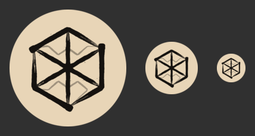

# TASK-14.6 — watchOS internal release validation

2026-10-25 · branch `task-14.6-watch-release`. **No upload or PR.** Local signed
export/inspection and simulator evidence only. TASK-14.6 remains **In Progress**;
AC4 is intentionally unchecked for the approved post-merge internal upload,
App Store Connect processing and owner's physical-watch installation/offline pass.

## Provenance and scope

All runtime code, assets, project membership and Fastfile are unchanged from
`e69bfca9caed91b454dbb5223e33a51bb256efdd` (the initial task-plan commit on main
`b5090fe03c3c8559770b261a68f726151751e969`). Only docs/evidence were edited during
validation; no app/package/project/signing configuration changed. The existing
icon and `ios beta` embedding path already satisfy the implementation boundary;
this task validates and documents them rather than adding a second upload lane.

Apple archives, exports and tests use **xbuild only** with
`DEVELOPER_DIR=/Applications/Xcode.app/Contents/Developer`. Fastlane also uses
`FASTLANE_SKIP_UPDATE_CHECK=1`. The runner invokes fastlane directly, **not wrapped
in lockf**. Shared-lock waits were respected and no other build was killed. The
normal dedicated `canadian-ham-build.keychain-db` and existing API-key paths were
used without printing secrets or handling the login keychain/password. The export
options keep `testFlightInternalTestingOnly=true` and
`manageAppVersionAndBuildNumber=false`.

## Icon visual review (AC1)

Reviewed the approved hex-beam/brush icon at native 1024 and circular **196, 88,
48 px**, not merely a scaled screenshot. Decision: **retain it unchanged**. All
six outer corners, the heavy perimeter, hub and six spreaders remain inside the
circle with ample cream breathing room. The 196px preview retains dry-brush cuts;
at 88/48px the finest cuts/splatter naturally merge, but the hex/spoke silhouette
and pale zigzag wires remain readable. No edge is clipped, and making the art
smaller or heavier would needlessly reduce the negative space. This is an agent
visual review, not a physical-watch display/owner design approval claim.

Before and after are deliberately **identical**: “before” is the existing family
export and “after” is the shipped watch icon, with no refinement needed. Both are
1024×1024 **RGB, no alpha**, cream **#E8D5B7**, SHA-256
`f908b05aa4a1410b1fb54e05ed82d7a314b9225ccb3e88e49c680c317b577f26`.
Only the review previews have transparent circular corners; the shipped icon
remains opaque and square, letting watchOS apply its own mask.

| Before (196 / 88 / 48 px) | After (retained, same sizes) |
| --- | --- |
|  |  |

Individual circular files:
[before 1024](../evidence/task-14.6/icon-before-circle-1024.png),
[196](../evidence/task-14.6/icon-before-circle-196.png),
[88](../evidence/task-14.6/icon-before-circle-88.png),
[48](../evidence/task-14.6/icon-before-circle-48.png);
[after 1024](../evidence/task-14.6/icon-after-circle-1024.png),
[196](../evidence/task-14.6/icon-after-circle-196.png),
[88](../evidence/task-14.6/icon-after-circle-88.png),
[48](../evidence/task-14.6/icon-after-circle-48.png).

Reproduce from the repository root with ImageMagick 7:

```sh
python3 docs/evidence/task-14.6/render-icon-previews.py
magick identify -format '%f %wx%h %[channels] %[pixel:p{0,0}]\n' \
  design/app-icon/exports/app-icon-1024.png \
  apps/apple/Platforms/watchOS/Resources/Assets.xcassets/AppIcon.appiconset/watch-icon-1024.png
```

The current Xcode **27.1 / 27A9275**, watchOS **27.0** SDK accepts the single
`idiom=universal, platform=watchos, size=1024x1024` AppIcon slot. The signed IPA's
`Assets.car` is **154,392 bytes**, with an opaque RGB `AppIcon` **1024×1024 Icon
Image** and a **MultiSized Image** entry (`1024x1024 index:1 idiom:watch`). The
watch Info.plist names AppIcon. No separate legacy size, dark/tinted or complication
variant is required by this build; no complications are shipped. Archive and
simulator asset-compiler warning searches are recorded with the command results
below. Other existing compiler/catalogue warnings are not represented as a
warning-free entire build.

## Signed export and watch inspection (AC2–3)

The existing **`fastlane ios beta`** is the watch beta entry path; no unsupported
ASC watch platform or second upload path was added. It passes one timestamp
`CURRENT_PROJECT_VERSION` to both iOS and watch targets. `export_only:true` runs
normal Release archive/export and returns **before** `upload_to_testflight`.

### iOS artifact

- Archive: `fastlane/archives/ios/CanadianHam-202610251833.xcarchive`
- IPA: `fastlane/builds/ios/202610251833/CanadianHam.ipa`
- IPA SHA-256: `4f95fb7527f6b45103e33535e296f11c7223ee0898c595a4afa41c45af9f1ddc`
- Watch: `Payload/CanadianHam.app/Watch/CanadianHamWatch.app`
- [Machine-readable inspection](../evidence/task-14.6/export-inspection.json)
  preserves metadata, **all** signed entitlements, icon renditions, linked
  libraries, exact non-study-file inventory, resource digest and signature results.

| Field | Exported value |
| --- | --- |
| Container ID | `org.davidjensenius.CanadianHam` |
| Watch ID | `org.davidjensenius.CanadianHam.watchkitapp` |
| Companion ID | `org.davidjensenius.CanadianHam` |
| `WKApplication` / independent flag | `true` / `true` |
| Container/watch version | `1.0.0` / `1.0.0` |
| Container/watch `CFBundleVersion` | **`202610251833` / `202610251833`**, matching timestamp |
| Watch platform / minimum | `WatchOS` / `27.0` |
| `UIBackgroundModes` / `WKBackgroundModes` | absent / absent |
| Signature | Apple Distribution: david jensenius (`9JALHNGRBQ`) |
| Verification | `codesign --verify --deep --strict --verbose=2` passes separately for phone and watch |
| Watch profile application identifier | `9JALHNGRBQ.org.davidjensenius.CanadianHam.watchkitapp` |
| Watch profile expiry | `2027-10-10T16:51:06Z` |
| Icon | `CFBundleIcons.CFBundlePrimaryIcon.CFBundleIconName=AppIcon`, compiled opaque icon described above |

Phone **and** watch signed entitlements contain only `application-identifier`,
`com.apple.developer.team-identifier`, `beta-reports-active=true`,
`get-task-allow=false`. No iCloud/CloudKit/container, push/`aps-environment` or
App Groups entitlement exists. Development signing during archive and distribution
re-signing during export both succeeded without a workaround.

The watch manifest is byte-identical to its source
(`Platforms/watchOS/Resources/PrivacyInfo.xcprivacy`), SHA-256
`521eb6ef8430773e5c010e1838fe9dd8fa5d62b7b76d1cea8d7d8daadcb144e2`:

```text
NSPrivacyTracking = false
NSPrivacyTrackingDomains = []
NSPrivacyCollectedDataTypes = []
NSPrivacyAccessedAPITypes = []
```

`otool -L` lists only Apple libraries/frameworks: Foundation, AVFAudio,
Accessibility, CoreFoundation, SwiftUI, weak UIKit, WatchKit and system/Swift
runtime libraries (full list in the JSON). **No WatchConnectivity, Network,
CFNetwork, CloudKit, analytics/telemetry or third-party library is directly linked;
no Frameworks directory or nested executable is bundled.** Swift runtime weak
compatibility overlays (including CoreLocation/SceneKit/XPC) are not app-level
location/scene/network features. This checks direct binary links plus app source
and package membership via the guards, not the transitive internals of Apple's
frameworks. Nothing claims Apple system frameworks never use networking internally.

### Exact resource verification

Python `plistlib`/JSON assertions checked **all 1,004 regular watch files**, not
just a forbidden-name grep:

- **988 JSONs**: four `basic-2025-07-15/{questions,categories,subsections,manifest}.json`
  plus **984** `explanations/<category>/<question>.json`. The bank has **984**
  bilingual Basic questions. Every JSON path and byte is identical to the source;
  raw study data totals **2,360,969 bytes**.
- The only other 16 files are the executable, `Assets.car`, `Info.plist`,
  `PkgInfo`, manifest, provisioning profile, code-signature resources and three
  localization files for each of en/fr/fr-CA. Exact names are in the JSON.
- **No** lesson, quiz, hint, Advanced bank, figure, Markdown/README, loose image,
  PDF, official reference sheet or test fixture/plugin is present.
- The iOS container **does** include `official-basic-exam/` under the existing
  internal-only `OFFICIAL_REFERENCE_SHEET` beta opt-in. Its watch does **not**,
  despite using that container archive command. No distribution gate was relaxed.
- Watch bundle regular files total **4,228,159 logical bytes** in this signed
  export, not an installed/on-device size or retained-memory claim.

Resource digest: SHA-256 of sorted lines `relativePath + ' ' + SHA256(file) + '\n'`
for all 988 JSON files is
`9122182849a193f888a9979c58af8dca601b4466c83507fd914b9d655cc1f32b`.

### Inspection commands

Local inspection root: `~/.cache/canadian-ham-task-14.6/` (`$EVIDENCE` below).
No profiles, certificates, signed apps/archives or secrets are committed. The
local `inspect-ipa.py` used `plistlib` and exact path/byte assertions as described
above; the committed JSON records its successful output.

```sh
EVIDENCE="$HOME/.cache/canadian-ham-task-14.6"
ditto -x -k fastlane/builds/ios/202610251833/CanadianHam.ipa "$EVIDENCE/ipa"
PHONE="$EVIDENCE/ipa/Payload/CanadianHam.app"
WATCH="$PHONE/Watch/CanadianHamWatch.app"
plutil -p "$WATCH/Info.plist"
plutil -p "$WATCH/PrivacyInfo.xcprivacy"
/usr/bin/assetutil --info "$WATCH/Assets.car"
codesign -d --entitlements :- "$PHONE"
codesign -d --entitlements :- "$WATCH"
codesign --verify --deep --strict --verbose=2 "$PHONE"
codesign --verify --deep --strict --verbose=2 "$WATCH"
codesign -dv --verbose=4 "$WATCH"
security cms -D -i "$WATCH/embedded.mobileprovision" # decode only, never commit profile
DEVELOPER_DIR=/Applications/Xcode.app/Contents/Developer xcrun otool -L "$WATCH/CanadianHamWatch"
python3 "$EVIDENCE/inspect-ipa.py"
```

### macOS regression export

The unchanged `fastlane mac beta export_only:true` also archives/exports
successfully through the dedicated keychain:

- Archive: `fastlane/archives/mac/CanadianHam-202610251835.xcarchive`
- PKG: `fastlane/builds/mac/202610251835/CanadianHam.pkg`
- SHA-256: `4cba4dd28339ea2d12cb10f89a4c58824204d21f217d3d6d912d782f0ea287c0`
- `pkgutil --check-signature` confirms the Apple-issued **3rd Party Mac Developer
  Installer: david jensenius (9JALHNGRBQ)** chain.
- `pkgutil --expand-full` expands all payloads. Exactly one `CanadianHam.app`
  exists: ID `org.davidjensenius.CanadianHam`, MacOSX, version `1.0.0`, timestamp
  build `202610251835`. Deep/strict app signature verification passes. There are
  **zero** Watch directories, CanadianHamWatch entries or watchkit-named files.
- [Machine-readable macOS results](../evidence/task-14.6/mac-export-inspection.json).

```sh
pkgutil --check-signature fastlane/builds/mac/202610251835/CanadianHam.pkg
pkgutil --expand-full fastlane/builds/mac/202610251835/CanadianHam.pkg "$EVIDENCE/mac-pkg"
codesign --verify --deep --strict --verbose=2 \
  "$EVIDENCE/mac-pkg/org.davidjensenius.CanadianHam.pkg/Payload/CanadianHam.app"
```

Both lane logs explicitly say **`Export only; skipping TestFlight upload`** and
have no `upload_to_testflight` step. No upload was attempted. The four-platform
Fastfile table/lane implementations are unchanged. tvOS/visionOS exports and
full iOS/macOS/tvOS/visionOS test suites were **not rerun**: this task changes no
runtime or shared source, project or lane code; the requested signed iOS/macOS
exports and complete watch scheme cover the release-validation scope. No
figure/title-sweep, web/content/package or localization suite was needed for
docs/evidence-only changes. Merge-batch/release-candidate suites remain the
coordinator's gate, not replaced by these exports.

## Owner upload and physical-watch results (pending)

**Not performed.** No TestFlight upload, processing, invitation, physical install,
VoiceOver listening or tactile validation was done by this agent. Export-only
build numbers above are **not processed TestFlight builds**. AC4 remains unchecked
and TASK-14.6 In Progress. After review/merge approval, the coordinator uploads from
main through the existing internal iOS lane; the owner records the processed
build/commit, watch model/watchOS, installation method and pass/fail observations.
No external groups, public link or App Store submission is authorized.

Follow the [installation and physical-watch checklist](../release/testflight.md#watchos-beta-entry-path-and-installation),
including phone out of range, explicit radio-off/Airplane Mode, practice/Crown
Confirm, Morse/reference/EN/FR, resident-bank memory/launch feel and cached-load
recovery. Complete **all three haptic styles in the same session** from
[TASK-14.3](task-14.3-watch-morse.md#owner-hardware-check), and
[TASK-14.5's listening/layout checks](task-14.5-watch-a11y.md#owner-manual-checks--pending-do-not-mark-ac4-complete).
Keep their hardware criteria blocked until actual observations exist; simulator
accessibility audits cannot establish heard speech or fixed-preset fidelity.

| Owner gate | Result |
| --- | --- |
| Approved upload / processed ASC version/build/commit | Pending post-merge |
| Physical watch model/watchOS/install method/tester/date | Pending owner |
| Practice, Morse, reference, EN/FR with phone absent and network off | Pending owner |
| Same-session three-style haptics, Silent Mode, tone alignment/cancellation | Pending owner; TASK-14.3 AC2 still open |
| VoiceOver, largest text, smallest hardware, language reset | Pending owner; TASK-14.5 owner gate still open |
| Memory/first-touch/launch feel and failure recovery | Pending owner |
